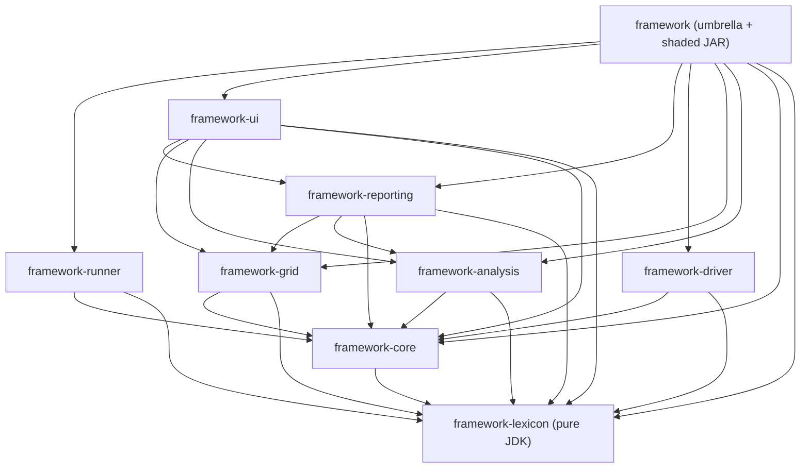
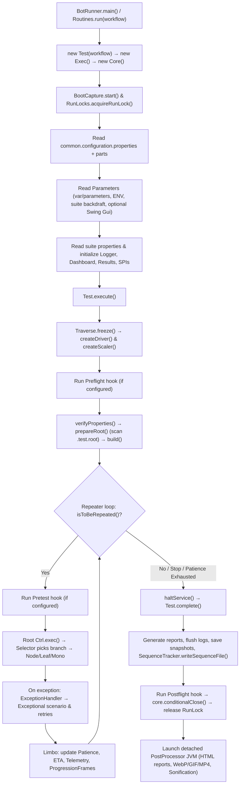

# bot-framework

**Autonomous, state-tree-driven UI test automation engine for Web (Selenium) and Android (Appium), built on Java 25.**

`bot-framework` replaces brittle, linear test scripts with a **self-navigating, weighted scenario tree**. You model an application's states and interactions as a Java package hierarchy of `Node`, `Leaf`, and `Mono` scenarios; the engine discovers the tree dynamically, selects paths probabilistically or deterministically, validates UI and visual pixel grids, calibrates live ETAs, classifies known issues and expected responses, and produces interactive HTML/SVG reports, progression videos, and procedural audio sonifications.

> **For Engineers & LLMs:** This README is designed as a self-contained encyclopedic reference for the entire repository so you can understand the architecture, module boundaries, SPI contracts, configuration precedence, execution algorithms, and extension points without scanning the full codebase first.

---

## Quick-Reference Cheat Sheet

| Concern | Primary Location / Symbol |
|---|---|
| **Maven Parent / Umbrella** | `works.lysenko:bot-framework-parent:0.26.48-SNAPSHOT` · `works.lysenko:framework` (also builds `-shaded.jar`) |
| **Java / Build Target** | Java **25** (`<maven.compiler.release>25</maven.compiler.release>`), Maven 3.9+, JUnit 5, JaCoCo |
| **Default CLI Entrypoint** | `works.lysenko.shared.BotRunner#main` → `works.lysenko.base.test.Routines#run(Workflow)` |
| **Workflow Hook Descriptor** | `works.lysenko.util.data.records.test.Workflow` (`preflight`, `pretest`, `status`, `exceptional`, `postflight`, `additional`) |
| **Global Runtime Anchor** | `works.lysenko.Base` (`tree`, `test`, `core`, `exec`, `properties`, `parameters`, `timer`) |
| **Scenario Base Classes** | `works.lysenko.tree.Root` → `Core` → `Node` / `Leaf` → `Mono`; `Exceptional` for recovery |
| **Tree Root & Discovery** | `works.lysenko.tree.Tree` + `ClassLoader.readFrom(rootPackage, false)` (configured via `.test.root`) |
| **Selection & Weights** | `works.lysenko.tree.Ctrl`, `works.lysenko.util.call.Selector`, `works.lysenko.util.func.core.Weights`, `SequenceTracker` |
| **Configuration System** | `works.lysenko.util.prop.PropEnum` (`.test.*`, `.tree.*`, `.grid.*`, `.logs.*`, `.webd.*`, `.mobi.*`, `.data.*`, `.screenshots.*`, `.swipes.*`) |
| **Execution Parameters** | `works.lysenko.base.Parameters` + `ExecutionParameter` (`SUITE`, `PLATFORM`, `EXHAUSTIVE`, `TESTS`, `HEADLESS`, `RESILIENT_MODE`, etc.) |
| **6 Pluggable SPIs** | `_DriverProvider`, `_EtaProvider`, `_DiagnosticsProvider`, `_GridProvider`, `_ReportingProvider`, `_UiProvider` |
| **Visual Grid Validation** | `works.lysenko.util.grid.validation.Check`, `Probe`, `Theme`, `BackgroundValidator` |
| **Detached Post-Processor** | `works.lysenko.base.output.PostProcessor` (waits for test JVM exit under `run/.postprocess.lock`) |
| **Headless Control Panel** | `dash/` directory (`dash/stop`, `dash/pause`, `dash/halt`, `dash/debug`, `dash/title`, `dash/eta`) |
| **Run Artifacts Root** | `result/runs/<suite>/<startTimestamp>/...` |

---

## Table of Contents

1. [Architecture & Multi-Module Topology](#1-architecture--multi-module-topology)
2. [Runtime Architecture & Execution Lifecycle](#2-runtime-architecture--execution-lifecycle)
3. [State-Tree Scenario Engine](#3-state-tree-scenario-engine)
4. [Locators, Descriptors & Assertions](#4-locators-descriptors--assertions)
5. [Configuration, Parameters & Properties Reference](#5-configuration-parameters--properties-reference)
6. [Web & Mobile Drivers](#6-web--mobile-drivers)
7. [Visual Grid & Colour Validation Engine](#7-visual-grid--colour-validation-engine)
8. [Analytics, ETA Calibration & Diagnostics](#8-analytics-eta-calibration--diagnostics)
9. [Logging, Telemetry & Reporting Pipeline](#9-logging-telemetry--reporting-pipeline)
10. [Interactive Swing UI & Headless Dashboard](#10-interactive-swing-ui--headless-dashboard)
11. [Lexicon Layer & Codebase Conventions](#11-lexicon-layer--codebase-conventions)
12. [Project Directory & Artifact Layout](#12-project-directory--artifact-layout)
13. [Building, Testing & Quickstart Guide](#13-building-testing--quickstart-guide)

---

## 1. Architecture & Multi-Module Topology

`bot-framework` is structured as a **9-module Maven reactor**. `framework-core` is strictly headless and decoupled from browser drivers, image processing, ETA analytics, HTML/video reporting, and Swing UI through six `java.util.ServiceLoader` Service Provider Interfaces (SPIs).

### Module Dependency Graph



### Module Inventory

| Module | Artifact ID | Dependencies (Internal / External) | Responsibility |
|---|---|---|---|
| **Lexicon** | `framework-lexicon` | Pure JDK 25 (zero runtime deps) | Bitwise character constants (`Symbols`), syllable constants (`__`..`_____`), word/phrase constants (`util.lang.*`, `shared.lang.*`), and `Synth` string primitives. |
| **Core** | `framework-core` | `lexicon`, `selenium-api`, `selenium-support`, Commons Math3 / Lang3 / Collections4 | Headless scenario tree engine (`Tree`, `Root`, `Core`, `Node`, `Leaf`, `Mono`, `Exceptional`, `Ctrl`, `Pool`), `Selector`, `Weights`, `SequenceTracker`, `Test`/`Repeater`/`Patience`, `Parameters`, `TestProperties`, `DataStorage`, logging & telemetry, `RunLocks`, headless `Directory` dashboard, and all 6 SPI contracts. Also publishes a `test-jar`. |
| **Analysis** | `framework-analysis` | `core`, `lexicon`, Jackson | Runtime `EtaCalculator`, historical `EtaCorrection`, Monte Carlo `CoverageEstimator`, `KnownIssuesStore`/`Matcher`, and `ExpectedResponsesStore`/`Matcher`. |
| **Grid** | `framework-grid` | `core`, `lexicon`, `jgrapht-core` | Screenshot capture, visual `OperationMarkers`, RGB/HSB/Palette/Polychromy pixel-grid validation (`Probe`, `Check`, `Theme`, `BackgroundValidator`), and `Ranger` range-verification. |
| **Driver** | `framework-driver` | `core`, `lexicon`, `selenium-java`, `webdrivermanager`, Appium `java-client`, OkHttp, BouncyCastle, Netty | Concrete Selenium WebDriver factory (`WebDrivers`) for Chrome/Firefox/Edge/Safari and Appium `AndroidDriver` + `AppiumDriverLocalService` lifecycle (`Driver`). |
| **Reporting** | `framework-reporting` | `core`, `analysis`, `grid`, `lexicon`, `graphviz-java`, `jsvg`, `webp-imageio`, `commons-exec`, Jackson | Detached `PostProcessor`, interactive HTML reports (`LogHtml`, `TreeHtml`, `KnownIssuesHtml`, `Scenarios`, `Tests`, `NewIssues`), `SummaryPlaque`, 16:9 `TreeLayoutOptimizer`, WebP/GIF/MP4 progression animations, and 10 procedural audio sonifiers. |
| **UI** | `framework-ui` | `core`, `analysis`, `grid`, `reporting`, `lexicon`, Jackson | Live Swing run dashboard (`UserInterface`), pre-run parameter launcher (`Gui` + `CycleEstimatorPanel`), embedded config/suite editor (`ConfigTestsEditorPanel`), visual `@VisualOffset` editor (`TreeLayoutEditorPanel` + `TreeLayoutAutoSolver`), and `KnownIssuesPanel`. |
| **Runner** | `framework-runner` | `core`, `lexicon` | Default `BotRunner` CLI entrypoint, `Agenda` workflow wiring, default lifecycle hooks (`Preflight`, `Pretest`, `Status`, `Specifics`, `Postflight`), and template `PropEnum`. |
| **Umbrella** | `framework` | Aggregates all 8 modules above | Drop-in single Maven dependency; also packages a fat `framework-<version>-shaded.jar` with `ServicesResourceTransformer` merging all `META-INF/services/*` descriptors. |

### `ServiceLoader` SPI Contracts

All cross-module integrations are defined as interfaces in `framework-core` and discovered automatically via `META-INF/services/`:

| SPI Interface (in `framework-core`) | Default Implementation | Module | Behavior When Absent |
|---|---|---|---|
| `works.lysenko.util.apis.execution._DriverProvider` | `works.lysenko.base.exec.DefaultDriverProvider` | `framework-driver` | `createDriver()` returns `null`; `scanPlatforms()` returns `List.of()`. |
| `works.lysenko.util.apis.core._EtaProvider` | `works.lysenko.base.eta.DefaultEtaProvider` | `framework-analysis` | Lifecycle hooks are no-ops; `resolveEtaJson(...)` returns `null`. |
| `works.lysenko.util.apis.core._DiagnosticsProvider` | `works.lysenko.base.issues.DefaultDiagnosticsProvider` | `framework-analysis` | No known-issue severity downgrade or expected-response neutralization. |
| `works.lysenko.util.apis.grid._GridProvider` | `works.lysenko.util.grid.DefaultGridProvider` | `framework-grid` | Screenshot/marker calls degrade gracefully; **`verifyImage(...)` fails closed (`false`)** and logs an `S1` event so visual assertions never silently pass. |
| `works.lysenko.util.apis.core._ReportingProvider` | `works.lysenko.base.output.DefaultReportingProvider` | `framework-reporting` | Reporting, frame tracking, and detached post-processing are skipped; default sonification mode list still available for validation. |
| `works.lysenko.util.apis.util._UiProvider` | `works.lysenko.base.ui.DefaultUiProvider` | `framework-ui` | Falls back automatically to headless `Directory` dashboard (`dash/`) and non-GUI parameter loading. |

### Core Dependency Versions

| Library | Version | Purpose |
|---|---|---|
| Java | 25 | Language & runtime (`ScopedValue`, records, switch expressions, unnamed `_` variables, `-XX:+UseCompactObjectHeaders`) |
| Selenium (`selenium-java`) | 4.49.0 | Browser WebDriver automation |
| WebDriverManager | 6.1.0 | Automatic browser binary/driver resolution |
| Appium (`java-client`) | 10.1.1 | Android mobile automation & local Appium service |
| Apache Commons Math3 | 3.6.1 | `Fraction` exact rational arithmetic & `EnumeratedDistribution` weighted sampling |
| Apache Commons Lang3 / Collections4 | 3.18.0 / 4.4 | String helpers & `CircularFifoQueue` |
| Jackson | 2.18.2 | JSON serialization (`known/issues.json`, `expected/responses.json`, `dash/eta`, ETA calibration) |
| Graphviz-Java / JGraphT | 0.18.1 / 1.5.2 | Graph topology & layout rendering |
| JSVG / WebP ImageIO | 1.6.1 / 0.10.0 | SVG rasterization & animated WebP encoding |
| JUnit Jupiter / JaCoCo / AspectJ | 5.11.4 / 0.8.16 / 1.9.27 | Unit testing, coverage reporting, and test-time weaving |

---

## 2. Runtime Architecture & Execution Lifecycle

### Global Runtime Anchor (`works.lysenko.Base`)

`works.lysenko.Base` is the central static facade holding the active session's runtime state and delegating convenience methods (`clickOn`, `find`, `findAll`, `typeInto`, `read`, `waitFor*`, `log`, `logDebug`, `logTrace`, `logEvent`, `section`, `sleep`, `put`/`getString`/`getInteger`/`getBoolean`, etc.):

- `Base.tree` (`works.lysenko.tree.Tree`) — Discovered root scenario tree.
- `Base.test` (`works.lysenko.base.Test`) — Session orchestrator (lifecycle, `Repeater`, `Patience`, `ExceptionHandler`, `Stat`).
- `Base.core` (`works.lysenko.base.Core`) — Run infrastructure (properties, logger, dashboard, results, run lock, stop flag/reason).
- `Base.exec` (`works.lysenko.base.Exec`) — Active execution context (`_Driver`, `_Scaler`, persistent `dataStorage`, transient `sessionStorage`, `_Scenarios`, `_Issues`, current execution phase).
- `Base.properties` (`works.lysenko.base.TestProperties`) — Layered property compendium.
- `Base.parameters` (`works.lysenko.base.Parameters`) — Resolved execution parameters.
- `Base.timer` (`works.lysenko.base.Stopwatch`) — Run start timestamp and monotonic elapsed milliseconds.

`Base.logEvent(Severity, String)` uses a Java 25 `ScopedValue<Boolean> LOG_EVENT_RECURSION_GUARD` to prevent re-entrant logging loops.

### `Workflow` Record & Lifecycle Hooks

Every run is configured by a `works.lysenko.util.data.records.test.Workflow`:

```java
public record Workflow(
    Class<? extends Runnable> preflight,   // Runs once after driver/scaler init, before root tree prep
    Class<? extends Runnable> pretest,     // Optional hook run before each individual test iteration
    Class<? extends _Status> status,       // Supplies custom status text for dashboard & logs
    Class<? extends _Scenario> exceptional,// Subclass of tree.base.Exceptional invoked on unhandled errors
    Class<? extends Runnable> postflight,  // Runs once during completion, after reports & before close
    Collection<Class<? extends _PropEnum>> additional // Project-specific _PropEnum definitions
)
```

A backward-compatible 5-argument constructor omits `pretest` (defaulting to `null`).

`framework-runner` supplies a ready-to-use `works.lysenko.shared.BotRunner` whose `main` method calls `Routines.run(Agenda.workflow)`. Consumer projects either use `BotRunner` directly or provide their own `main` class passing a custom `Workflow`.

### End-to-End Execution Flow



### Execution Modes & Termination Conditions

1. **Fixed Cycle Count (`TESTS=N` / `.test.tests=N`)**
   - Executes up to `N` top-level root cycles (each cycle traverses from the root tree down to a leaf or halted node), stopping early if a critical event reaches `.test.fail.by.event.of.severity`, a safeguard trips, all scenarios become non-executable, or a manual stop is requested.
2. **Exhaustive Mode (`EXHAUSTIVE=true` / `.test.exhaustive=true`)**
   - Continues cycling until every accessible `Leaf` has been executed at least `EXHAUSTIVE_PASSES` times (default `1`) and every accessible `Mono` has been executed once.
   - Guarded by **Wandering Patience** (`works.lysenko.base.test.Patience`): tracks consecutive fruitless cycles since the last leaf goal progress. The idle budget is:
     $$\text{idleBudget} = \max\left(1.0,\ \frac{\text{patience}}{2.0} \cdot \max(\text{totalLeafExecutions},\ \text{progressTestNumber})\right)$$
     where `patience = .tree.exhaustive.patience` (default `2`). Progress toward 100% is shaped by `.tree.exhaustive.patience.steepness` (`1` = linear, `>1` = slow-to-quick, `0..1` = quick-to-slow). When patience reaches 100%, the run aborts cleanly with an `S3` notice instead of looping forever on unreachable leaves.
   - Pairs naturally with **Exact Passes** (`EXACT_PASSES=true` / `.tree.exact.passes=true`), which marks fulfilled leaves non-executable (`weight = 0`) so remaining cycles concentrate on unvisited leaves.
3. **Resilient Mode (`RESILIENT_MODE=true` / `.test.resilient.mode=true`)**
   - Instead of halting the entire session on the first scenario failure or lost session, marks the failed scenario and continues executing remaining paths to collect all failures in a single run.

### Concurrency Locks & Boot Capture

- **`RunLocks`** (`works.lysenko.base.core.RunLocks`) prevents overlapping executions in the same workspace via OS `FileChannel` locks:
  - `run/.run.lock` — Exclusive lock held by an active test run (fails immediately with `IllegalStateException` if already held).
  - `run/.postprocess.lock` — Exclusive lock acquired by detached `PostProcessor` processes (subsequent post-processors wait in queue until the prior one completes).
- **`BootCapture`** (`works.lysenko.base.core.BootCapture`) tees `System.out` during early startup before the run log file exists, then flushes buffered boot messages into the run log so the HTML report includes a complete **Booting** section.

### Process Exit Codes (`works.lysenko.util.data.enums.ExitCode`)

| Exit Code | Enum Constant | Meaning |
|---:|---|---|
| `0` | `SUCCESS` | Test session completed normally. |
| `10` | `UNHANDLED_EXCEPTION` | Unhandled top-level exception outside test execution. |
| `11` | `TESTS_UNHANDLED_EXCEPTION` | Unhandled exception during test completion/finalization. |
| `12` | `FAILED_ASSERTION` | Fatal assertion failure. |
| `13` | `SAFEGUARD_FAILED` | Safeguard tripped (`SafeguardException`: execution-time, depth, or history-depth limit). |
| `14` | `SCENARIO_FAILED` | Fatal `ScenarioRuntimeException`. |
| `20` | `EXECUTION_FAILURE` | General execution failure. |
| `30` | `UNDEFINED_BROWSER` | Unsupported/undefined browser platform requested. |
| `31` | `CLOSED_THROUGH_GUI` | Operator closed/cancelled execution via the Swing setup GUI. |
| `32` | `PLATFORMS_RESET` | Cached `var/platforms` was reset via GUI; restart required. |

---

## 3. State-Tree Scenario Engine

### Package-as-Tree Paradigm

The scenario tree is **isomorphic to Java packages**:

1. Set `.test.root` (e.g., `com.example.scenarios`) in configuration.
2. `Tree` scans `.test.root` for top-level `_Scenario` implementations — these become **level-1 branches**.
3. When a `Node` class (e.g., `com.example.scenarios.Login`) is instantiated with its default constructor, it computes its **child package** by lowercasing the first letter of its simple class name: `com.example.scenarios.login`. All `_Scenario` classes in that subpackage are automatically discovered via `ClassLoader.readFrom(childPackageName(), false)` and added to the node's `Ctrl` / `Pool`.
4. **Alias / Extension Nodes:** If a class extends another `Node` subclass (rather than `Node` directly), `Node#childPackageName()` walks up to the nearest direct subclass of `Node`, so the subclass shares its ancestor's child package as an alias. Enabling `.tree.traverse.extensions=true` lets weights and downstream weights resolve through the superclass chain as well.
5. **Explicit Composition:** A `Node` may alternatively pass explicit child instances via `super(childA, childB)`, a custom package name via `super("my.pkg")`, or swap its pool dynamically at runtime with `setSubScenarios(...)`.

### Scenario Type Hierarchy

```
works.lysenko.tree.Root (UI/Wait/Log/Data/Session DSL)
 └── works.lysenko.tree.Core (_Scenario, Verifies, weights, status, lifecycle)
      ├── works.lysenko.tree.base.Node   [▷] — Branch: action() → verify() → ctrl.exec() → finals()
      ├── works.lysenko.tree.base.Leaf   [◆] — Terminal: action() → verify() → finals()
      │    └── works.lysenko.tree.base.Mono [◼] — Single-execution Leaf (runs at most once per session)
      └── works.lysenko.tree.base.exceptional.Core [●]
           └── works.lysenko.tree.base.Exceptional — Exception analyzer & recovery scenario
```

| `ScenarioType` | Symbol Tag | Upstream Weight | Execution Semantics |
|---|:---:|---|---|
| `NODE` | `▷` | Cumulative child weights (`Weights.upstreamWeight`) | Runs `action()`, runs `verify()` (if WebDriver active), selects and executes one child via `ctrl.exec()` unless `halt()` was called, then runs `finals()`. |
| `LEAF` | `◆` | Always `Fraction.ZERO` | Terminal test step: `action()` → `verify()` → `finals()`. Executable until failed or (when `exactPasses=true`) execution count reaches target. |
| `MONO` | `◼` | Always `Fraction.ZERO` | Specialized `Leaf` that sets `executed = true` upon first successful run and returns `isExecutable() == false` thereafter (target is always `1`). |
| `CORE` | `●` | Base | Internal / exceptional scenarios (`Exceptional`). |

### Execution Status (`works.lysenko.util.data.enums.ExecutionStatus`)

Every scenario tracks a first-class status rendered across logs, SVG trees, HTML reports, and progression animations:

| Status | Code | Hex Color | Meaning |
|---|---|---|
| `UNVISITED` | `unvisited` | `#64748b` | Never executed during the run. |
| `PASSED` | `passed` | `#22c55e` | Executed cleanly without warnings or failures. |
| `WARNING` | `warning` | `#f59e0b` | Executed with warnings, non-failing notices, or downgraded known issues. |
| `FAILED` | `failed` | `#ef4444` | Failed directly or threw an unhandled exception during `fits()`/`action()`/`verify()`/`finals()`. |
| `CHILD_FAILED` | `child_failed` | `#fbbf24` | `Node`'s own `action()` succeeded, but a descendant scenario failed. |

### Scenario Lifecycle Hooks

When authoring a `Node`, `Leaf`, or `Mono`, override any combination of:

- **`boolean fits()`** — Prerequisite guard checked *before* execution. Default behavior follows `.tree.fits.by.default` (`false` unless overridden). Returning `false` removes the scenario from the current selection candidate pool (and may prune/penalize it).
- **`void action() throws SafeguardException`** — Primary interaction logic. Defaults to calling `verify()`.
- **`boolean verify() throws SafeguardException`** (from `Verifies`) — Post-action verification hook automatically invoked after `action()` whenever a WebDriver is active.
- **`void finals() throws SafeguardException`** — Cleanup/teardown step run after `action()` (and after child execution in a `Node`).
- **`String info()`** — Short status/diagnostic string printed in logs and summaries (returns `"halted"` on halted `Node`s).
- **`void halt()`** (on `Node`) — Skips child scenario selection for the current iteration while still executing `finals()`.

### `Root` DSL Capabilities

Every scenario extends `works.lysenko.tree.Root`, inheriting 15 modular capability interfaces from `works.lysenko.util.apis.common.*` plus two built-in key-value stores:

- **Element Interaction:** `ClicksOnWebElements`, `TypesIntoWebElements`, `ClearsWebElements`, `ReadsWebElements`, `SendsKeys`, `DescribesWebElements`
- **Element Discovery & Sync:** `SearchesWebElements`, `WaitsForWebElements`, `Sleeps`
- **Navigation & Gestures:** `OperatesOnUrl`, `Scrolls`, `Swipes`
- **Logging & Control:** `WritesLog`, `ControlsExecution`, `Runs`
- **Dual Test Data Storage:**
  - `data` (`Root.Data` → `exec.dataStorage`): Persistent across runs when `.data.persist=true` (saved in `var/<suite>.data.properties`), with optional per-write snapshots (`.data.snapshots.allowed`, `.data.snapshots.full`).
  - `session` (`Root.Session` → `exec.sessionStorage`): Transient in-memory key-value store scoped strictly to the current run.

### Weight Resolution, Selection & Pruning

Scenario weights are represented as exact rational `org.apache.commons.math3.fraction.Fraction` values (`1`, `0.5`, `1/3`, `-` for disabled).

1. **Own Weight Resolution Order (`Weights.ownWeight`):**
   1. **Coded weight** passed to `super(Fraction weight)` constructor (highest precedence).
   2. **Configured weight** by scenario short name (e.g., `login.InvalidPassword=2.5`) or class name in suite/config properties.
   3. **Superclass extension weight** (when `.tree.traverse.extensions=true`).
   4. **Default weight** from `.tree.default.weight` (default `0.0`).
   - A value of `-` disables a scenario (`NaN` / excluded from execution).
2. **Propagation Modes:**
   - **Downstream weight (`.tree.include.downstream=true`):** Weight configured on a parent scenario cascades down to all descendants.
   - **Upstream weight (`.tree.include.upstream=true`):** Weight configured on leaf/child scenarios propagates upward to ancestor nodes so you only need to weight leaves in a suite file.
3. **Dynamic Selection (`Selector`):**
   - Filters to executable candidates (`isExecutable()`).
   - Applies **completion boost** (`.tree.completion.weight`, default `4.5`) so branches with unfulfilled leaf work are strongly favored over already-covered branches.
   - Applies **branch stale penalty** (`.tree.branch.stale.penalty=true`) to penalize unproductive branches whose children repeatedly fail `fits()`.
   - Samples candidates using Apache Commons Math `EnumeratedDistribution` (or follows an active sequence script).
   - Evaluates `fits()`: if `false`, removes the candidate from the pool, optionally marks it exhausted (`.tree.unreachable.leaf.pruning=true`), increments stale count, and retries up to `.test.scenario.sufficiency.attempts` (default `9`). Negative weights are treated as critical errors.

### Deterministic Replay & Sequence Scripting (`SequenceTracker`)

- **Automatic Recording:** Every executed scenario's canonical class key (relative to `.test.root`) is recorded and saved at run end to `<timestamp>.scenarios.sequence`.
- **Scripted Replay:** Supply a sequence file path via environment variable `SEQUENCE`, JVM property `-DSEQUENCE=...`, or `-Dtree.sequence.file=...` (one canonical key per line; `#` comments ignored).
- **Modes (`.tree.sequence.mode`):**
  - `SUGGESTION` (default) — Prefers the next scripted scenario if present and fitting, otherwise falls back seamlessly to weighted selection.
  - `ORDER` — Strictly enforces the scripted order; if the next scripted scenario cannot be selected, logs an event at `.tree.sequence.failure.severity` (default `S0`).

### Safeguards & Exception Recovery

- **Execution-Time Safeguard (`.test.execution.time.safeguard`, default `20|2000`):** Uses a `CircularFifoQueue<Long>` to detect runaway fast-failing loops (e.g., 20 consecutive cycles finishing in under 2000 ms total) and raises `SafeguardException`.
- **Depth & History Safeguards:** `.tree.scenario.depth.safeguard` (default `20`) and `.tree.scenario.history.depth.safeguard` (default `20`) protect against infinite recursion or cyclic sub-scenario pools.
- **`Exceptional` Recovery Pipeline (`works.lysenko.tree.base.Exceptional`):**
  - Captures a failure screenshot tagged with the ultimate root cause class name and logs the cause triplet (`ultimate`, `penultimate`, `antepenultimate`).
  - Handles Selenium `TimeoutException` (extracts unreachable locators; on Android dumps all visible `TextView` texts for diagnostics; detects Android launcher crashes), `StaleElementReferenceException`, and `UnreachableBrowserException`.
  - When `.webd.recreate.driver.after.exception=true`, restarts the driver automatically; otherwise stops execution unless `RESILIENT_MODE` is active.
  - `ExceptionHandler` retries up to `.test.exception.retries` (default `3`).

### Visual Layout Annotations

Annotate any scenario class to tune its position in rendered SVG/HTML tree diagrams without changing its logical depth:

- `@VisualOffset(int value)` — Shifts the scenario and its subtree horizontally by `value` columns.
- `@VisualRowOffset(int value)` — Shifts the target vertical row of the scenario in the layout solver.

These annotations can also be edited visually and written directly back to Java source files using `TreeLayoutEditorPanel` (`ScenarioOffsetSourceCodec`).

---

## 4. Locators, Descriptors & Assertions

### `Locators.by(String locator)` Auto-Detection

`works.lysenko.util.func.ui.Locators` converts a string seamlessly into an `org.openqa.selenium.By`:

1. **XPath:** Any string starting with `//`, `./`, `.//`, `(.//`, or `(//` → `By.xpath(locator)`.
2. **CSS Selector:** Any string starting with `#`, containing ` > `, or containing `:nth-` → `By.cssSelector(locator)`.
3. **Named Descriptor:** Any other string is resolved through `Descriptors.get(locator)` and recursively parsed via `by(...)`.
4. **Random Variant:** `Locators.by(String... locators)` picks one locator uniformly at random from the varargs list.

### `Descriptors` (`src/main/resources/locators`)

- Loads key/locator mappings at startup from `src/main/resources/locators`, split on `==` (`<key>==<xpath-or-css>`).
- Supports parameterized locator templates via `Descriptors.fill(templateKey, values...)` (printf-style formatting).
- Built-in fallback for `"content"` / `"Content"`: resolves to `//android.widget.FrameLayout` on Android and `//body` on Web.
- Transient descriptors can be registered at runtime with `Descriptors.put(key, value)`.

### `Assertions` (`works.lysenko.util.func.core.Assertions`)

- Provides typed `assertEquals`, `assertNotEquals`, `assertTrue`, `assertFalse`, `assertNotNull`, `assertNull`, `fail`, and `Fraction`/floating-point comparisons (`EPSILON = 1.0E-10`).
- Every assertion logs its expected vs actual values, logs failures at `.test.assertions.severity` (default `S0`), and optionally throws when `.test.assertions.produce.exception=true`.

---

## 5. Configuration, Parameters & Properties Reference

### Layered Precedence (Lowest → Highest)

1. **Built-in `_PropEnum` Defaults** (`works.lysenko.util.prop.PropEnum` + any project enums registered via `Workflow.additional`).
2. **Common Configuration** (`src/main/resources/config/common.configuration.properties`) and modular `.part` files loaded via `.include=parts/tests,parts/data,...` (`src/main/resources/config/parts/*.part`).
3. **Suite Configuration** (`src/main/resources/suites/<suite>.suite` and any `.include`d suite `.part` files).
4. **Persisted Parameters** (`var/parameters`) — automatically backdrafted from suite config when switching suites (`.test.suite.change.updates.parameters=true`).
5. **Environment Variables & Interactive GUI Overrides** — environment variables matching `ExecutionParameter` names (or custom additional parameters) override file values; in non-CI interactive runs with `framework-ui` on the classpath, the Swing setup `Gui` allows last-minute overrides before launch.

### `_PropEnum` Naming & Extension

Every property enum implementing `_PropEnum` automatically maps its constant name to a dot-prefixed lowercase property key by replacing `_` with `.`:
- `_TEST_EXHAUSTIVE` → `.test.exhaustive`
- `_TREE_COMPLETION_WEIGHT` → `.tree.completion.weight`

*(Three swipe marker keys override `getPropertyName()`: `_SWIPE_LINE_MARKER_COLOUR` → `.swipes.marker.line.colour`, `_SWIPE_START_MARKER_COLOUR` → `.swipes.marker.start.colour`, `_SWIPE_STOP_MARKER_COLOUR` → `.swipes.marker.stop.colour`.)*

Suite files hold **both** dotted framework/project properties (`.test.*`, `.tree.*`, etc.) and **un-dotted scenario weight keys** (e.g., `myBranch.MyLeaf=1.0`). `PropertyValidator` and `ClasspathSubtypeScanner` validate keys, types, and enum values in real time.

### Execution Parameters (`ExecutionParameter`)

| Parameter | Default | Purpose |
|---|---|---|
| `SUITE` *(alias `TEST`)* | `""` | Suite file name under `src/main/resources/suites/<suite>.suite`. |
| `OLD_SUITE` | `""` | Tracks previously selected suite to trigger backdraft on suite switch. |
| `PLATFORM` | `Chrome` | Target platform: `Chrome`, `Firefox`, `Edge`, `Safari`, or `Android`. |
| `DOMAIN` | `""` | Target web URL / domain (web platforms). |
| `DEVICE` | `""` | Target Android device identifier (Android platform). |
| `POOL` | `""` | Users pool file under `etc/<pool>.users`. |
| `HEADLESS` | `false` | Run desktop browser headlessly. |
| `TESTS` | `""` | Fixed number of root test cycles to execute. |
| `EXHAUSTIVE` | `false` | Run until all accessible leaves meet their execution goal. |
| `EXHAUSTIVE_PASSES` | `""` | Required passes per leaf in `EXHAUSTIVE` mode (default `1`). |
| `EXHAUSTIVE_PATIENCE` | `""` | Overrides `.tree.exhaustive.patience` wandering budget factor. |
| `EXACT_PASSES` | `false` | Marks fulfilled leaves non-executable (`weight = 0`). |
| `RESILIENT_MODE` | `false` | Continues execution after scenario/session exceptions to collect all failures. |
| `COMPLETION_WEIGHT` | `""` | Overrides `.tree.completion.weight` unfinished-work bias. |
| `HIDE_OFF_BRANCHES` | `false` | Hides completely disabled (`OFF`) branches in tree reports. |
| `TRAVERSE_EXTENSIONS` | `false` | Resolves weights through scenario superclass chains. |
| `ORIGIN` | `""` | Optional metadata label (e.g., CI job / trigger source) shown on summary plaques. |
| `TAG` | `""` | Optional run tag displayed on summary plaques and reports. |

### Built-in Properties Compendium (`works.lysenko.util.prop.PropEnum`)

<details>
<summary><strong>Test Execution, Modes & Safeguards (`.test.*`)</strong></summary>

| Property | Type | Default | Description |
|---|---|---|---|
| `.test.root` | `String` | `""` *(config sets `link.tree`)* | Root Java package of the scenario tree. |
| `.test.app` | `String` | `""` | Path to Android APK or package under test. |
| `.test.bundle.id` | `String` | `null` | Mobile application bundle/package ID for launch/restart. |
| `.test.tests` | `Integer` | `null` | Number of test cycles to run (fixed mode). |
| `.test.exhaustive` | `Boolean` | `false` | Enable `EXHAUSTIVE` execution mode. |
| `.test.exhaustive.passes` | `Integer` | `1` | Target passes per leaf in `EXHAUSTIVE` mode. |
| `.test.headless` | `Boolean` | `false` | Launch WebDriver in headless mode. |
| `.test.resilient.mode` | `Boolean` | `false` | Continue collecting failures after exceptions. |
| `.test.ewait` | `Integer` | `30` | Explicit wait timeout (seconds). |
| `.test.action.retries` | `Integer` | `3` | Retry attempts for UI actions. |
| `.test.exception.retries` | `Integer` | `3` | Retry attempts after exceptional UI states. |
| `.test.scenario.sufficiency.attempts` | `Integer` | `9` | Max candidate selection retries when `fits()` returns `false`. |
| `.test.execution.time.safeguard` | `String` | `20\|2000` | Minimum duration (`cycles\|ms`) for consecutive tests before tripping safeguard. |
| `.test.fail.by.event.of.severity` | `Severity` | `s1` | Stop session on any event at or above this severity. |
| `.test.assertions.produce.exception` | `Boolean` | `true` | Throw exception on assertion failure. |
| `.test.assertions.severity` | `Severity` | `s0` | Severity recorded for failed assertions. |
| `.test.long.operation.threshold` | `Integer` | `9999` | Milliseconds threshold for flagging slow operations. |
| `.test.long.operation.severity` | `Severity` | `s2` | Severity for slow-operation events. |
| `.test.max.typing.delay` | `Integer` | `50` | Max simulated per-character typing delay (ms). |
| `.test.pause.length` | `Integer` | `5000` | Polling interval (ms) while paused. |
| `.test.known.issues.failed.only` | `Boolean` | `false` | Restrict known-issue markers in reports to executed & failed nodes. |
| `.test.suite.change.updates.parameters` | `Boolean` | `true` | Backdraft parameters from suite config upon switching suite. |

</details>

<details>
<summary><strong>Tree Topology, Selection, Layout & Sequence (`.tree.*`)</strong></summary>

| Property | Type | Default | Description |
|---|---|---|---|
| `.tree.default.weight` | `String` | `0.0` | Weight for scenarios without explicit configuration. |
| `.tree.completion.weight` | `Fraction` | `4.5` | Bias multiplier toward unfinished leaf work. |
| `.tree.fits.by.default` | `Boolean` | `false` | Default return value of `fits()` when not overridden. |
| `.tree.exact.passes` | `Boolean` | `false` | Zero out weight of fulfilled leaves. |
| `.tree.unreachable.leaf.pruning` | `Boolean` | `true` | Mark non-fitting scenarios exhausted during selection. |
| `.tree.branch.stale.penalty` | `Boolean` | `true` | Penalize unproductive branches failing to yield executable leaves. |
| `.tree.include.downstream` | `Boolean` | `false` | Cascade parent weights down to descendants. |
| `.tree.include.upstream` | `Boolean` | `false` | Propagate child weights up to ancestor nodes. |
| `.tree.traverse.extensions` | `Boolean` | `false` | Resolve weights through scenario superclass chains. |
| `.tree.ignore.failed.scenario.selection` | `Boolean` | `false` | Allow continuation when candidate selection fails. |
| `.tree.exhaustive.patience` | `Fraction` | `2` | Wandering patience budget multiplier. |
| `.tree.exhaustive.patience.steepness` | `Fraction` | `1` | Curvature of patience consumption curve (`1` linear). |
| `.tree.scenario.depth.safeguard` | `Integer` | `20` | Max nesting depth before `SafeguardException`. |
| `.tree.scenario.history.depth.safeguard` | `Integer` | `20` | Max history depth safeguard. |
| `.tree.sequence.mode` | `SequenceMode` | `SUGGESTION` | Replay mode: `SUGGESTION` or `ORDER`. |
| `.tree.sequence.failure.severity` | `Severity` | `S0` | Severity when `ORDER` mode cannot select scripted step. |
| `.tree.hide.off.branches` | `Boolean` | `false` | Omit entirely `OFF` branches from tree layouts. |
| `.tree.hide.passed.leaves` | `Boolean` | `false` | Hide passing leaves to focus on warnings/failures. |
| `.tree.progression.optimization` | `Boolean` | `true` | Enable 16:9 multi-bank layout optimization. |
| `.tree.progression.optimization.max.aspect.ratio` | `Double` | `1.78` | Target aspect ratio (16:9) for bank packing. |
| `.tree.progression.optimization.bank.columns` | `Integer` | `0` | Bank count (`0` = auto, `1` = disabled, `>=2` = fixed). |
| `.tree.progression.optimization.pack.columns` | `Integer` | `2` | Multi-column leaf packing width. |
| `.tree.progression.optimization.shallow.max.depth` | `Integer` | `12` | Max depth for shallow-tree classification. |
| `.tree.progression.optimization.shallow.min.ratio` | `Double` | `2.0` | Min node-to-depth ratio for wide-tree classification. |
| `.tree.progression.optimization.shallow.threshold` | `Integer` | `2` | Min leaf children to pack in shallow-wide trees. |
| `.tree.progression.optimization.standard.threshold` | `Integer` | `6` | Min leaf children to pack in standard trees. |
| `.tree.allow.dynamic.reordering` | `Boolean` | `false` | Allow live bank reordering during run. |
| `.tree.allow.final.reordering` | `Boolean` | `true` | Re-optimize bank layout once at run completion. |
| `.tree.reduce.horizontal.gaps` / `.vertical.gaps` | `Boolean` | `true` | Collapse completely empty columns/rows. |
| `.tree.reduce.horizontal.offsets` / `.vertical.offsets` | `Boolean` | `true` | Compact `@VisualOffset` / `@VisualRowOffset` whitespace. |
| `.tree.min.offset.separation` | `Integer` | `1` | Minimum preserved column/row gap when compacting offsets. |
| `.tree.progression.movement.speed` | `Fraction` | `1` | Animation easing speed (`>=5` instant snap). |
| `.tree.progression.debug` | `Boolean` | `false` | Overlay coordinates & camera vector on progression frames. |
| `.tree.notify.about.empty.scenario.packages` | `Boolean` | `true` | Notice when a scanned package has no scenarios. |
| `.tree.scenario.does.not.fit.notice` / `.not.executable.notice` | `Boolean` | `true` | Log `S3` notices when scenarios fail `fits()` or `isExecutable()`. |
| `.tree.mute.fulfilled.not.executable.notice` / `.empty.candidates.notice` / `.downstream.weight.change.notice` | `Boolean` | `false` | Demote routine operational notices to debug level. |

</details>

<details>
<summary><strong>Reporting, Progression Media & Sonification (`.test.report.*`)</strong></summary>

| Property | Type | Default | Description |
|---|---|---|---|
| `.test.report.open.html` | `Boolean` | `true` | Auto-open generated HTML report in system browser. |
| `.test.report.add.exhaustive` / `.add.cpu.debug` / `.add.eta.debug` | `Boolean` | `true` | Include Exhaustive Completion, CPU/RAM, and ETA Debug charts in `run.log.html`. |
| `.test.report.cpu.density` / `.cpu.density.per.test` | `Integer` / `Boolean` | `5000` / `true` | Max telemetry points & per-test downsampling. |
| `.test.report.log.scale.*` (`exhaustive`, `cpu.debug`, `eta.debug`, `timeline`) | `Boolean` | `false` | Start corresponding report chart in logarithmic scale. |
| `.test.report.progression.tree` / `.scenario` | `Boolean` | `true` | Enable tree and scenario-coverage progression tracking. |
| `.test.report.progression.tree.webp` / `.mp4` / `.gif` | `Boolean` | `true` / `true` / `false` | Output formats for tree progression animation. |
| `.test.report.progression.scenario.webp` / `.mp4` / `.gif` | `Boolean` | `true` / `true` / `false` | Output formats for scenario coverage progression animation. |
| `.test.report.progression.tree.per.node` | `Boolean` | `false` | Capture a tree frame on every node execution (vs per cycle). |
| `.test.report.progression.scenario.label.level` | `Integer` | `0` | Grouping depth for scenario chart bars (`0` = auto). |
| `.test.report.progression.tree.sonification` | `Boolean` | `true` | Attach procedural audio soundtrack to tree progression MP4. |
| `.test.report.progression.tree.sonifications` | `String` | `edm, dnb, neon, jmj, carbon` | Pool of sonifier engines sampled randomly per run. |
| `.test.report.progression.ffmpeg` | `String` | `ffmpeg` | FFmpeg binary name or path for MP4 muxing. |
| `.test.report.progression.max.frames` | `Integer` | `5000` | Max frames retained per animation. |
| `.test.report.progression.max.frame.pixels` / `.max.total.pixels` | `Integer` / `Long` | `168M` / `100G` | Pixel-budget safeguards for rasterization. |

</details>

<details>
<summary><strong>WebDriver, Mobile, UI, Data, Math & Logging (`.webd.*`, `.mobi.*`, `.screen.*`, `.data.*`, `.math.*`, `.logs.*`)</strong></summary>

| Property | Type | Default | Description |
|---|---|---|---|
| `.webd.iwait` | `Integer` | `1000` | Implicit wait (ms). |
| `.webd.forced.platform` | `String` | `null` | Override automatic platform selection. |
| `.webd.recreate.driver.after.exception` | `Boolean` | `true` | Recreate driver after browser/session exceptions. |
| `.mobi.native.x.resolution` / `.y.resolution` | `Integer` | `1080` / `2280` | Native reference screen resolution for coordinate scaling (`Scaler`). |
| `.mobi.ud.id` | `String` | `""` | Explicit Android device UDID. |
| `.screen.to.spawn.dashboard` | `Integer` | `0` | Monitor index for Swing dashboard placement. |
| `.data.delimiter.l0` / `.l1` / `.l2` | `String` | `\|` / `,` / `;` | Multi-level serialization delimiters. |
| `.data.persist` | `Boolean` | `false` | Persist `DataStorage` across runs. |
| `.data.snapshots.allowed` / `.snapshots.full` | `Boolean` | `false` / `false` | Snapshot test data on mutation (diff or full). |
| `.math.fractions.accuracy` / `.output` | `Integer` / `Boolean` | `9` / `false` | Decimal precision & fractional rendering toggle. |
| `.logs.debug` / `.trace` / `.adebug` | `Boolean` | `false` | Enable debug, trace, and Appium diagnostic logging. |
| `.logs.table.width` | `Integer` | `99` | Width for formatted log tables. |
| `.logs.time.stamp.format` | `String` | `.000` | Fractional-seconds timestamp pattern. |
| `.logs.md.timestamps` / `.md.durations` | `Boolean` | `false` / `true` | Control timestamps & duration spans in Markdown logs. |
| `.logs.to.read` | `String` | `""` | Browser/driver log types to harvest (e.g., `browser,driver`). |
| `.logs.silent.sleeping.threshold` | `Integer` | `10` | Suppress log lines for sleeps shorter than threshold (ms). |
| `.logs.lines.similarity.check` / `.delta` / `.depth` / `.limit` | Mixed | `true` / `3000` / `1` / `99` | Duplicate/similar log-line detection & grouping. |
| `.logs.lines.similarity.exceptions.permanent` / `.temporary` | `String` | `""` | Patterns exempt from similarity grouping. |
| `.logs.rate.1` / `.2` / `.3` / `.4` | `Integer` | `19` / `49` / `99` / `999` | Log-rate colorization thresholds. |
| `.logs.full.stacktrace` / `.line.number.in.short.stacktrace` / `.stack.trace.references` | `Boolean` | `false` / `false` / `true` | Stack-trace verbosity and deduplicated reference folding. |
| `.logs.ignored.in.stacktrace` | `String` | `""` | Comma-separated class names filtered from short traces. |

</details>

<details>
<summary><strong>Grid Validation, Screenshots & Swipes (`.grid.*`, `.screenshots.*`, `.swipes.*`)</strong></summary>

| Property | Type | Default | Description |
|---|---|---|---|
| `.grid.default.resolution` | `String` | `3*3` | Default sampling grid dimensions. |
| `.grid.default.horisontal` / `.vertical` / `.scale` | `String` | `1/2` / `1/2` / `1` | Default relative region center & scale. |
| `.grid.default.colour.ranged.margin` / `.hsv.margin` / `.polychromy.margin` | `String`/`Fraction` | `0` | Default tolerance margins for RGB, HSB, and polychromy checks. |
| `.grid.colour.similarity.threshold` | `Double` | `1` | Colour similarity threshold. |
| `.grid.verify.colours` | `Boolean` | `false` | Enable colour verification pass. |
| `.grid.validation.default.border` / `.fences` / `.hsb.threshold` / `.scale.epsilon` | Mixed | `1/999` / `9` / `1/99` / `0.0001` | Core geometric and HSB validation tolerances. |
| `.grid.wide.range.threshold` | `Fraction` | `1/22` | Threshold above which a range is flagged as wide. |
| `.grid.allowed.margin.severity.reduction` / `.other.severity.reduction` | `Integer` | `2` / `2` | Maximum severity downgrade permitted within tolerated margins. |
| `.grid.empty.grid.validation.allowed` | `Boolean` | `false` | Permit validation of zero-cell grids. |
| `.grid.empty.result.severity` / `.null.result.severity` | `Severity` | `s0` / `s0` | Severities for empty/null validation outcomes. |
| `.grid.update.colour.expectations` / `.hsv.expectations` / `.polychromy.expectations` / `.passed.expectations` / `.shrink.expectations` | `Boolean` | `false` | Self-updating/tightening `.grid` expectation file modes. |
| `.grid.stamps.process` / `.display` / `.compress` | `Boolean` | `true` | Grid visual stamp generation and compression. |
| `.grid.ranger.log.*` (`absent.range`, `boundaries`, `non.failing.out.of.bounds`, `order.change`, `overstretch`, `scale.check`, `scale.debug`, `sort.check`, `wide.range`, `width`) | `Boolean`/`Integer` | `true` / `96` | Granular Ranger diagnostic logging flags. |
| `.grid.log.line.max.length` | `Integer` | `999` | Max grid log line length. |
| `.grid.action.marker.colour` | `Color` | `255,128,0,128` | RGBA colour for action overlay markers. |
| `.screenshots.marker.variant` | `String` | `neutral` | Marker style: `neutral`, `military`, or `classic`. |
| `.screenshots.of.clicks` / `.long.clicks` / `.swipes` / `.binds` / `.pixels` | `Boolean` | `false` | Automatic screenshot capture on UI interactions & grid probes. |
| `.screenshots.of.long.clicks.marker.diameter` | `Integer` | `50` | Pixel diameter for long-click marker circles. |
| `.swipes.default.reduction` / `.medium.reduction` / `.big.reduction` / `.default.weight` | `Float` | `-2.0` / `-4.5` / `-10.0` / `1.0` | Gesture coordinate reduction & weighting coefficients. |
| `.swipes.marker.line.colour` / `.start.colour` / `.stop.colour` | `Color` | `0,0,0,128` / `0,255,0,128` / `255,0,0,128` | RGBA swipe annotation colours. |

</details>

---

## 6. Web & Mobile Drivers

Implemented in `framework-driver` and exposed through `_DriverProvider` (`DefaultDriverProvider`):

- **Desktop Web (`WebDrivers`):**
  - Supports `Platform.CHROME`, `Platform.FIREFOX`, `Platform.EDGE`, and `Platform.SAFARI`.
  - Automatically resolves and caches matching driver binaries via **WebDriverManager**.
  - Honors `HEADLESS` (`--headless` options), window maximization (when non-headless), and registers JVM shutdown hooks so browser/driver child processes are terminated cleanly on any exit path.
- **Android Mobile (`Driver`):**
  - Spawns and manages a local `AppiumDriverLocalService` (writing logs to `result/appium.log`) and creates an `AndroidDriver` using `.test.app` (default `bin/anfang.apk`), `.test.bundle.id`, and `.mobi.ud.id`.
  - Pairs with `works.lysenko.base.exec.Scaler` using `.mobi.native.x.resolution` and `.mobi.native.y.resolution` to translate coordinate-based gestures across differing physical device densities.
- **Platform Discovery (`Platforms`):**
  - Scans locally available browsers/drivers and caches them in `var/platforms` for fast GUI selection; can be reset via the GUI (`ExitCode.PLATFORMS_RESET`).

---

## 7. Visual Grid & Colour Validation Engine

Implemented in `framework-grid` and bridged via `_GridProvider` (`DefaultGridProvider`):

### How Grid Validation Works

Instead of brittle pixel-for-pixel diffs, `bot-framework` samples a **parametric geometric grid** (rectangular or elliptical, defined in `.grid` files under `src/main/resources/grids/`) over a fullscreen or `WebElement` screenshot and validates statistical colour distributions via `Check` and `Probe`:

1. **Colour Quotas (`ColoursQuotas`):** Verifies expected RGB24 colours (or named/themed colours) fall within configured fractional share ranges (`FractionRange` / `IntegerRange`) with configurable `RangedMargin` tolerances and `ColoursIgnore` rules.
2. **HSB Channel Quotas (`QuotasHSB`):** Validates Hue, Saturation, and Brightness distributions independently against `.grid.validation.hsb.threshold`.
3. **Palette & Polychromy (`Palette`, `Polychromy`):** Checks overall colour diversity and palette membership using configurable `PolychromyMethod`s.
4. **Bit-Planes & Stamps (`BitPlane`, `Painter`):** Produces visual diagnostic overlays and compressed ASCII/bitmap grid stamps in logs.
5. **Ranger Engine (`AbstractRanger`, `OfIntegers`, `OfFractions`):** Performs ordered range validation with detailed diagnostics (absent ranges, overstretch, order swaps, scale drift, wide-range warnings) and configurable severity reduction.
6. **Self-Updating Baselines:** Enabling `.grid.update.*.expectations=true` or `.grid.shrink.expectations=true` lets the framework capture or tighten `.grid` expectations directly from live runs.
7. **Background Validation (`BackgroundValidator`):** Validates screen/element backgrounds asynchronously with configurable failure severity.

### Theme-Aware Validation (`Theme`)

`works.lysenko.util.grid.Theme` decouples `.grid` specifications from hard-coded colours:
- Store semantic palettes in `src/main/resources/themes/<name>.colours` (e.g., `SURFACE_BG=#090d16`, `ACCENT=WHITE`, or signed ARGB integers, referencing `known/colours` for 480+ built-in named colours).
- Reference semantic token names inside `.grid` files.
- Bind the active theme globally (`Theme.setActive(theme)`) or dynamically per-thread / structured virtual thread scope using Java 25 `ScopedValue` (`Theme.withActive(theme, runnable)`), or pass it directly via `Check.byGrid("header", "dark")`.

### Visual Operation Markers (`OperationMarkers`)

When `.screenshots.of.clicks`, `.long.clicks`, or `.swipes` are enabled, captured screenshots are annotated with element bounding boxes, tap points, labels, and swipe vectors in one of three visual styles (`.screenshots.marker.variant`): `neutral`, `military`, or `classic`.

---

## 8. Analytics, ETA Calibration & Diagnostics

Implemented in `framework-analysis` and bridged via `_EtaProvider` and `_DiagnosticsProvider`:

### Runtime ETA & Historical Calibration

- **`EtaCalculator`** computes live remaining runtime across three modes:
  - `EXHAUSTIVE` — Combines remaining leaf executions with wandering-patience ETA (`Patience#estimateEtaMs`).
  - `FIXED_TESTS` — Uses completed cycles and elapsed runtime against `totalTests`.
  - `LEAF_FALLBACK` — Falls back to observed leaf discovery rate when no fixed total is set.
- **`EtaCorrection`** learns from completed runs (`CorrectionStore`, `CorrectionInterpolator`, `CompletionSidecarReader`), recording run metadata and correcting raw linear estimates for the coupon-collector slowdown typical of random tree traversal.
- **Sidecar Logs:** Emits `<ts>.eta-debug.log`, `<ts>.exhaustive-completions.log`, and throttled JSON snapshots to `dash/eta` every second for both Swing UI and external monitors.

### Monte Carlo Coverage Estimator (`CoverageEstimator`)

- Compiles the live scenario tree (`CompiledCoverageTree`) into a compact primitive representation and runs high-speed **Monte Carlo trials** (`MonteCarloSimulator`) incorporating `completionWeight`, `Mono` limits, and target leaf executions.
- Estimates the average number of cycles required to achieve 100% leaf coverage — exposed programmatically and interactively in the setup GUI via `CycleEstimatorPanel`.

### Known Issues (`known/issues.json`)

Loaded from `src/main/resources/known/issues.json` (with classpath and legacy fallbacks) into `KnownIssuesStore`:

```json
{
  "issues": [
    {
      "scenario": "checkout.ApplyCoupon",
      "title": "BUG-142: Intermittent coupon timeout",
      "description": "Backend latency occasionally exceeds 30s on staging",
      "link": "https://tracker.example.com/BUG-142",
      "pattern": "TimeoutException",
      "decrease-to-warning": true
    }
  ]
}
```

- Supports `{ "issues": [...] }`, scenario-grouped `{ "scenarios": [...] }`, top-level `[...]` arrays, and multi-target `"scenarios": [...]` lists.
- When a failure event matches a `KnownIssue` with `decrease-to-warning: true` (default), `_DiagnosticsProvider#shouldDecreaseToWarning` downgrades the event from `FAILURE`/`SEVERE` to `WARNING` so known bugs do not abort or fail CI builds while remaining clearly badged in HTML/SVG reports (`<ts>.issues.html`).
- A run-scoped snapshot is archived to `<ts>.known.issues.json`.

### Expected Responses (`expected/responses.json`)

Loaded from `src/main/resources/expected/responses.json` into `ExpectedResponsesStore`:

```json
{
  "responses": [
    {
      "scenario": "auth.InvalidLogin",
      "pattern": "401 Unauthorized",
      "reason": "Negative test intentionally submits invalid credentials"
    }
  ]
}
```

- Supports `"scenario"` (defaults to `"*"` wildcard when omitted) or `"scenarios": [...]` for multi-scenario matching.
- Neutralizes anticipated browser console errors or negative-test failure signals via `_DiagnosticsProvider#isExpectedEvent` so intentional negative tests stay `PASSED`.
- Archived per run to `<ts>.expected.responses.json`.

---

## 9. Logging, Telemetry & Reporting Pipeline

### Structured Logging & System Telemetry

- **Dual Rendering (`framework-core`):**
  - `AnsiLogRenderer` produces color-coded ANSI console output, Swing `AnsiTextPane` updates, and raw `<ts>.run.log`.
  - `MarkdownLogRenderer` produces LLM- and human-readable `<ts>.run.log.md` plus per-test files under `md/<testNumber>.md` (configurable timestamps and duration spans).
- **Noise Reduction:**
  - **Similarity Grouping:** Collapses repetitive log bursts within `.logs.lines.similarity.delta` (3000 ms) using `LimitedDeque`.
  - **Stack-Trace Shortening & Reference Folding:** Strips internal framework frames (`.logs.ignored.in.stacktrace`) and replaces repeated stack traces with indexed references stored in `<ts>.callstacks.properties`.
- **Event Severities (`works.lysenko.util.data.enums.Severity`):**
  - `S0` (`FAILURE`, Magenta) · `S1` (`SEVERE`, Red) · `S2` (`WARNING`, Yellow) · `S3` (`NOTICE`, Cyan).
- **JVM & OS Telemetry (`Telemetry`):**
  - Samples process CPU %, heap usage, thread count, loaded/total class counts, and elapsed time (rate-limited at 250 ms CPU windows to avoid syscall overhead) into `<ts>.telemetry.log`.

### Detached Post-Processor (`PostProcessor`)

When a test run ends, `DefaultReportingProvider` spawns a **detached child JVM** (`DetachedProcessLauncher`) so the test JVM exits immediately and releases resources. The `PostProcessor`:
1. Acquires `run/.postprocess.lock` (queuing behind any previous post-processor).
2. Waits up to 60 seconds for the parent test JVM PID to exit cleanly.
3. Optionally opens `PostProcessorProgressUI` (non-headless runs).
4. Generates all HTML reports, SVG trees, progression frames, animations, and audio tracks, and optionally opens `<ts>.run.log.html` in the browser.

### Generated Reports & Visual Architecture (`framework-reporting`)

| Artifact | Generator | Contents |
|---|---|---|
| `<ts>.run.log.html` | `LogHtml` (`LogParser`, `ChartsRenderer`, `TimelineRenderer`, `SectionRenderer`) | Full interactive report with `SummaryPlaque`, collapsible sections (Booting, Preflight, Test Cycles, Postflight), execution duration timeline, CPU/RAM telemetry chart, ETA debug chart, Exhaustive Completion chart, inline screenshots, and links to animations & sub-reports. |
| `<ts>.tree.html` | `TreeHtml` (`TreeLayoutComputer`, `TreeLayoutOptimizer`, `SvgTreeRenderer`) | Interactive vector SVG state-tree diagram color-coded by `ExecutionStatus`, showing execution counts, weights, known-issue badges, and tooltips. Automatically compacts tall/narrow trees into 16:9 multi-bank layouts with multi-column leaf packing. |
| `<ts>.scenarios.html` | `Scenarios` | Tabular per-scenario execution statistics, weights, counts, and outcomes. |
| `<ts>.tests.html` | `Tests` | Per-cycle test history, durations, and executed paths. |
| `<ts>.issues.html` | `KnownIssuesHtml` | Matched and unmatched known issues for the run. |
| `<ts>.issues.{notice,warning}.html` | `NewIssues` | Newly observed warnings and notices not covered by `known/issues.json`. |
| Tree & Scenario Progression Media | `TreeTracker`, `ScenarioTracker`, `ProgressionFrames`, `AnimatedWebP`, `AnimatedGifWriter`, `ProgressionMp4` | Cycle-by-cycle (or node-by-node) animated WebP, GIF, and FFmpeg MP4 videos with smooth node gliding (`TreeNodePositionAnimator`), camera pan/zoom (`TreeCameraTransform`), and progress chrome (`ProgressionChrome`). |

### Procedural Musical Sonification (`works.lysenko.base.output.sonifier`)

When `.test.report.progression.tree.sonification=true`, tree progression MP4s include a **deterministic procedural WAV soundtrack** synthesized directly from tree execution events (depths, statuses, milestones, warnings, failures) and muxed via FFmpeg. Ten synthesizer/sonifier engines are registered in `TreeProgressionAudio`:

- **Default random pool:** `edm` (`EdmSonifier`/`EdmSynth` - 128 BPM deadmau5 progressive house with filter sweep chords & sidechain pump), `dnb` (`DnbSonifier`/`DnbSynth`), `neon` (`NeonSonifier`/`NeonSynth`), `jmj` (`JmjSonifier`/`JmjSynth`), `carbon` (`CarbonSonifier`/`CarbonSynth`)
- **Additional engines:** `copilot`, `claude`, `gemini`, `orpheus`, `aurora` (or `none` to disable)

---

## 10. Interactive Swing UI & Headless Dashboard

### Live Run Dashboard (`_Dashboard`)

- **Interactive Mode (`framework-ui` → `UserInterface`):** Swing dashboard showing real-time ANSI-colored logs (`AnsiTextPane`), current scenario breadcrumb, live JVM/OS telemetry (cores, threads, CPU %, loaded classes, MiB memory, runtime, calibrated ETA), screenshot/SVG preview, and interactive toggle buttons (`Pause/Resume`, `Halt`, `Stop`, `Debug`).
- **Headless / CLI Mode (`framework-core` → `Directory`):** Automatically used inside CI, Docker, headless environments, or when `framework-ui` is omitted from the classpath. Mirrors dashboard controls via plain files in `dash/`:
  - Create `dash/pause`, `dash/halt`, `dash/stop`, or `dash/debug` to control a running bot from any shell or script.
  - Read `dash/title` for current run status and `dash/eta` for a live JSON `EtaSnapshot` (updated every 1 s).

### Pre-Run Setup GUI & Embedded Tools (`framework-ui`)

- **`Gui` + `CycleEstimatorPanel`:** Pre-run Swing launcher for choosing suite, platform, domain/device, user pool, execution mode (`TESTS` vs `EXHAUSTIVE`), flags, and running the Monte Carlo `CoverageEstimator` with a live progress bar before starting execution.
- **`ConfigTestsEditorPanel`:** Micro-IDE panel for browsing and editing `common.configuration.properties`, `.part` files, and `.suite` files with a structured table view, raw text toggle, and real-time `PropertyValidator` diagnostics.
- **`TreeLayoutEditorPanel`:** Interactive visual layout workbench for `@VisualOffset` and `@VisualRowOffset` annotations featuring a pan/zoom tree canvas (`TreeLayoutEditorCanvas`), hierarchy/table navigator, keyboard nudging, undo/redo, automated aspect-ratio solver (`TreeLayoutAutoSolver`), and safe Java source rewriting (`ScenarioOffsetSourceCodec`).
- **`KnownIssuesPanel`:** Interactive viewer and editor for `known/issues.json`.

---

## 11. Lexicon Layer & Codebase Conventions

### `framework-lexicon`

`framework-lexicon` is a zero-dependency pure-JDK module providing reusable constants and string synthesis utilities used throughout the framework:

- **`works.lysenko.util.spec.Symbols`:** Character constants constructed bitwise via `Chars.booleansToChar(...)` across 4–16 bit widths (`_SPACE_`, `_DOT_`, `_SLASH_`, `_COMMA_`, `_COLON_`, `VRT_BAR`, `FAT_BUL`, digits `_0_`–`_9_`, etc.).
- **`works.lysenko.util.chrs.__` / `___` / `____` / `_____`:** 2-, 3-, 4-, and 5-character constant syllables/tokens.
- **`works.lysenko.util.lang.word.*` & `works.lysenko.util.lang.*`:** Alphabetical word and phrase dictionaries (`A`–`Z`) plus `works.lysenko.shared.lang.*` for runner/shared vocabulary.
- **`works.lysenko.util.spec.Synth` & `util.data.strs.*`:** Compact string-building DSL (`s(...)` concatenate, `sn(...)` null-safe concat, `b(...)` space/delimiter bind, `d(...)` dash-join, `c(...)` capitalize, `q(...)` quote, `e(Brackets, ...)` enclose).

### Naming & Coding Conventions

- **Underscore-Prefixed Interfaces:** Internal/SPI contract interfaces are prefixed with `_` (e.g., `_Scenario`, `_Node`, `_Pool`, `_Ctrl`, `_Driver`, `_DriverProvider`, `_PropEnum`, `_Dashboard`, `_GridProvider`).
- **Utility `record`s:** Stateless utility namespaces are frequently declared as empty Java `record`s (e.g., `public record Weights()`, `public record Assertions()`, `public record Check()`, `public record BotRunner()`).
- **Modern Java 25 Idioms:** Uses `ScopedValue` for recursion guards and dynamic `Theme` binding, unnamed pattern/catch variables (`_`), compact object headers (`-XX:+UseCompactObjectHeaders`), and records for immutable data models.

---

## 12. Project Directory & Artifact Layout

Defined centrally in `works.lysenko.util.spec.Layout`:

```text
<consumer-project>/
├── src/main/
│   ├── java/<root.package>/               # Scenario tree (.test.root)
│   │   ├── BranchA.java                   # Level-1 Node (scans <root.package>.branchA)
│   │   └── branchA/
│   │       ├── StepOne.java               # Leaf
│   │       └── InitOnce.java              # Mono
│   └── resources/
│       ├── config/
│       │   ├── common.configuration.properties   # Uses .include=parts/...
│       │   └── parts/*.part                      # Modular property groups
│       ├── suites/
│       │   └── <suite>.suite                     # Suite overrides & scenario weights
│       ├── grids/
│       │   └── <name>.grid                       # Visual grid validation specs
│       ├── themes/
│       │   └── <name>.colours                    # Semantic colour palettes
│       ├── known/
│       │   ├── issues.json                       # Known issues registry
│       │   └── colours                           # Named colour dictionary
│       ├── expected/
│       │   └── responses.json                    # Expected error/response rules
│       └── locators                              # Descriptor map (key==xpath-or-css)
├── etc/
│   └── <pool>.users                              # Optional user credential pools
├── bin/
│   └── anfang.apk                                # Default Android APK path (override via .test.app)
├── var/
│   ├── parameters                                # Persisted execution parameters
│   ├── platforms                                 # Cached locally detected platforms
│   └── <suite>.data.properties                   # Persisted DataStorage (when .data.persist=true)
├── dash/                                         # Headless runtime dashboard & control flags
│   ├── title                                     # Current status title
│   ├── eta                                       # Live JSON EtaSnapshot (updated every ~1s)
│   └── {stop,pause,halt,debug}                   # Touch/write "true" to control active run
├── run/
│   ├── .run.lock                                 # Exclusive active-run OS file lock
│   └── .postprocess.lock                         # Post-processor serialization lock
└── result/
    ├── appium.log                                # Local Appium server log
    └── runs/<suite>/<startTimestamp>/
        ├── <ts>.run.log                          # Raw ANSI run log
        ├── <ts>.run.log.md                       # Markdown run log
        ├── <ts>.run.log.html                     # Interactive master HTML report
        ├── <ts>.tree.html                        # Interactive SVG scenario tree report
        ├── <ts>.scenarios.html                   # Scenario statistics report
        ├── <ts>.tests.html                       # Per-cycle test history report
        ├── <ts>.issues.html                      # Known issues report
        ├── <ts>.issues.{notice,warning}.html     # New issues reports
        ├── <ts>.scenarios.sequence               # Recorded replayable scenario sequence
        ├── <ts>.telemetry.log                    # CPU/RAM/threads/classes time series
        ├── <ts>.eta-debug.log                    # ETA estimation & calibration log
        ├── <ts>.exhaustive-completions.log       # Leaf completion timestamps
        ├── <ts>.callstacks.properties            # Deduplicated stack trace archive
        ├── <ts>.known.issues.json                # Run-scoped known issues snapshot
        ├── <ts>.expected.responses.json          # Run-scoped expected responses snapshot
        ├── md/<cycle>.md                         # Per-cycle Markdown logs
        ├── snapshots/                            # Captured & annotated PNG screenshots
        └── data/                                 # DataStorage mutation snapshots
```

---

## 13. Building, Testing & Quickstart Guide

### Prerequisites

- **JDK 25** (with `--enable-native-access=ALL-UNNAMED` and `-XX:+UseCompactObjectHeaders` configured automatically in Surefire).
- **Maven 3.9+**.
- *(Optional)* **FFmpeg** on `PATH` (or configured via `.test.report.progression.ffmpeg`) for MP4 video & sonification muxing.
- *(Optional)* **Appium** + Android SDK/ADB for Android mobile execution.

### Building & Running Framework Tests

```bash
# Compile and run the full JUnit 5 test suite across all 9 modules (+ JaCoCo reports)
mvn test

# Build and install all modules (including framework-<version>-shaded.jar) to local ~/.m2
mvn clean install

# Run tests for a single module
mvn -pl framework-core test
```

Surefire reports are written to `<module>/result/surefire-reports`, and JaCoCo coverage reports to `<module>/target/site/jacoco/index.html`.

### Adding `bot-framework` to a Consumer Project

**Option A — Drop-in Umbrella (all features enabled):**
```xml
<dependency>
  <groupId>works.lysenko</groupId>
  <artifactId>framework</artifactId>
  <version>0.26.48-SNAPSHOT</version>
</dependency>
```

**Option B — Minimal Headless Composition (pick only needed modules):**
```xml
<!-- Always required -->
<dependency>
  <groupId>works.lysenko</groupId>
  <artifactId>framework-core</artifactId>
  <version>0.26.48-SNAPSHOT</version>
</dependency>
<!-- Add any subset of SPI providers as needed -->
<dependency>
  <groupId>works.lysenko</groupId>
  <artifactId>framework-driver</artifactId>
  <version>0.26.48-SNAPSHOT</version>
</dependency>
<dependency>
  <groupId>works.lysenko</groupId>
  <artifactId>framework-analysis</artifactId>
  <version>0.26.48-SNAPSHOT</version>
</dependency>
<dependency>
  <groupId>works.lysenko</groupId>
  <artifactId>framework-reporting</artifactId>
  <version>0.26.48-SNAPSHOT</version>
</dependency>
```

### Minimal Scenario Tree Example

**1. Define a Level-1 `Node` (`com.example.scenarios.Dashboard`):**
```java
package com.example.scenarios;

import works.lysenko.tree.base.Node;
import works.lysenko.util.apis.exception.checked.SafeguardException;

public class Dashboard extends Node {

    @Override
    public boolean fits() {
        return isPresent("//nav[@id='main-menu']");
    }

    @Override
    public void action() throws SafeguardException {
        clickOn("//a[@href='/dashboard']");
    }
    // Automatically discovers all scenarios in package `com.example.scenarios.dashboard`
}
```

**2. Define a `Leaf` (`com.example.scenarios.dashboard.FilterActive`):**
```java
package com.example.scenarios.dashboard;

import works.lysenko.tree.base.Leaf;
import works.lysenko.util.apis.exception.checked.SafeguardException;

import static works.lysenko.util.func.core.Assertions.assertTrue;

public class FilterActive extends Leaf {

    @Override
    public boolean fits() {
        return isPresent("#filter-active");
    }

    @Override
    public void action() throws SafeguardException {
        clickOn("#filter-active");
    }

    @Override
    public boolean verify() throws SafeguardException {
        assertTrue(isPresent("//table[@data-filter='active']"), "Active filter table should be visible");
        return true;
    }
}
```

**3. Define a Suite (`src/main/resources/suites/smoke.suite`):**
```properties
.test.root=com.example.scenarios
.test.exhaustive=true
.test.exhaustive.passes=1
.tree.exact.passes=true
.tree.include.upstream=true

# Assign weights to leaf scenarios (upstream propagation automatically weights Dashboard)
dashboard.FilterActive=1.0
```

**4. Execute (CLI / Headless):**
```bash
SUITE=smoke PLATFORM=Chrome DOMAIN=https://app.example.com HEADLESS=true EXHAUSTIVE=true \
  java --enable-native-access=ALL-UNNAMED -XX:+UseCompactObjectHeaders \
  -cp target/classes:path/to/framework-0.26.48-SNAPSHOT-shaded.jar \
  works.lysenko.shared.BotRunner
```
